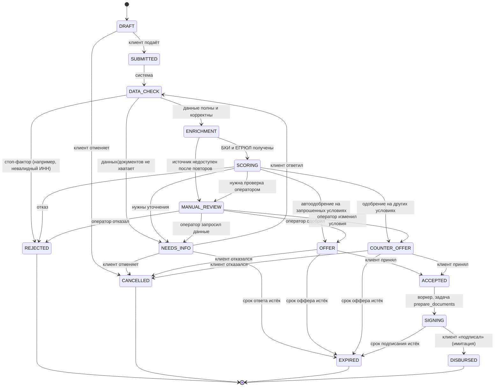

# Автомат состояний заявки

Владелец: Участник 2 (реализация), Участник 1 (согласование логики). Изменения только через PR `contract`.

## Диаграмма

## Статусы и что видит клиент

| Статус | Смысл | Текст для клиента (черновик) | Кто двигает |
|---|---|---|---|
| `DRAFT` | Черновик | Заполните заявку и отправьте на рассмотрение | клиент |
| `SUBMITTED` | Принята | Мы получили заявку и скоро начнём проверку | система |
| `DATA_CHECK` | Проверка полноты и корректности | Проверяем данные и документы | воркер |
| `NEEDS_INFO` | Нужны уточнения | Нам не хватает информации: ответьте на вопросы ниже | клиент |
| `ENRICHMENT` | Запрос данных из БКИ и госреестров | Сверяем сведения о компании | воркер |
| `SCORING` | Оценка риска и решение | Оцениваем заявку | воркер |
| `MANUAL_REVIEW` | Разбор оператором | Заявку рассматривает специалист банка | оператор |
| `OFFER` | Предложение на запрошенных условиях | Банк одобрил заявку, посмотрите условия | клиент |
| `COUNTER_OFFER` | Предложение других условий | Банк готов предложить другие условия | клиент |
| `ACCEPTED` | Клиент принял | Условия приняты, готовим документы | воркер (задача `prepare_documents` → `SIGNING`) |
| `SIGNING` | Подписание (имитация) | Подпишите документы | клиент (`/sign`); сам статус выставляет воркер |
| `DISBURSED` | Выдача (имитация) | Средства выданы (демо) | клиент (`/sign`), актор перехода `CLIENT` |
| `REJECTED` | Отказ | Банк не может одобрить заявку. Причины ниже | финал |
| `CANCELLED` | Отмена клиентом | Заявка отменена | финал |
| `EXPIRED` | Истёк срок действия | Срок действия заявки/оффера истёк | финал |

Для `REJECTED` клиенту показываются **человекочитаемые причины** (коды из `reason_codes`, см. `SCORING.md`), без раскрытия внутренней скоринговой карты. Оператор видит полный разбор.

## Правила переходов (guards)

1. Любой переход выполняется только через `state_machine.transition(application, to_status, actor, reason, payload)`.
2. Допустимые пары «из → в» строго соответствуют диаграмме; всё остальное даёт ошибку `409 INVALID_TRANSITION`.
3. Актор перехода проверяется: клиентские переходы доступны только владельцу заявки, операторские только `OPERATOR`/`ADMIN`, системные только воркеру.
4. Каждый переход пишет строку в `application_status_history` (`from`, `to`, `actor_type`, `actor_id`, `reason_code`, `comment`, `created_at`) в той же транзакции, что и смена статуса.
5. Переходы идемпотентны для воркера: повторная обработка уже обработанного шага не меняет заявку (проверка текущего статуса и `version` для оптимистичной блокировки).
6. Таймеры (`NEEDS_INFO_TTL_HOURS`, `OFFER_TTL_HOURS`, `SIGNING_TTL_HOURS`) проверяет воркер по расписанию и переводит в `EXPIRED`.
7. Цикл уточнений ограничен `MAX_INFO_ROUNDS` (по умолчанию 2). При повторном входе в `DATA_CHECK` из `NEEDS_INFO` уже полученные `enrichment_results` со статусом `OK` переиспользуются, источники повторно не опрашиваются. Если лимит раундов исчерпан, заявка уходит в `MANUAL_REVIEW` (причина `INFO_ROUNDS_EXCEEDED`).
8. Отмена клиентом допустима только из `DRAFT`, `NEEDS_INFO`, `OFFER`, `COUNTER_OFFER`; из остальных статусов `409 INVALID_TRANSITION`.
9. `take` (взять в работу) статус не меняет: пишется аудит-событие и `assigned_operator_id`; заявку, занятую другим оператором, взять нельзя (`409 CONFLICT`). Решение принимает только назначенный оператор.
10. Цепочка после оффера — см. раздел «Цепочка после оффера» ниже (единое правило, остальные места только ссылаются на него).
11. `expires_at` зависит от статуса: `NEEDS_INFO` → +`NEEDS_INFO_TTL_HOURS`, `OFFER`/`COUNTER_OFFER` → `valid_until` оффера, `SIGNING` → +`SIGNING_TTL_HOURS`; в остальных статусах `null`.
12. Зависшие задачи: воркер возвращает в `PENDING` задачи `RUNNING` с `locked_at` старше `JOB_LOCK_TIMEOUT_SEC`; заявка в `DATA_CHECK`/`ENRICHMENT`/`SCORING` без активной задачи пересоздаёт её (watchdog).
13. Из финальных статусов (`REJECTED`, `CANCELLED`, `EXPIRED`, `DISBURSED`) переходов нет. Новая попытка — новая заявка (можно «повторить заявку» копированием данных).

## Цепочка после оффера (единое правило)

| Шаг | Что происходит | Актор | Источник | Итоговый статус |
|---|---|---|---|---|
| 1 | Клиент принимает оффер | `CLIENT` | `POST /offer/accept`; в той же транзакции ставится задача `prepare_documents` | `ACCEPTED` |
| 2 | Воркер «формирует документы» (имитация) | `SYSTEM` | задача `prepare_documents` | `SIGNING` |
| 3 | Клиент «подписывает» | `CLIENT` | `POST /sign`, допустим только в `SIGNING` | `DISBURSED` |

- Ответ `accept` содержит заявку в статусе `ACCEPTED`, а не `SIGNING`. Клиент видит переход в `SIGNING` через SSE или опрос.
- В `ACCEPTED` у клиента нет действий (`next_action = NONE`); `sign` в этом статусе — `409 INVALID_TRANSITION`.
- Если `prepare_documents` не выполнена (сбой воркера), задача повторяется по правилам повторов; заявка не зависает (watchdog, правило 12).
- `expires_at` в `SIGNING` = момент входа в статус + `SIGNING_TTL_HOURS`; истечение → `EXPIRED`.

## События для интерфейса
Клиент узнаёт об изменении через `GET /applications/{id}/events` (SSE, читается через `fetch` с заголовком `Authorization`, heartbeat каждые 15 с) с запасным вариантом: опрос `GET /applications/{id}` с `ETag`/`If-None-Match` каждые 2–3 секунды. `ETag` = `"<version>"`; `version` растёт при каждом изменении заявки, включая смену статуса. Событие: `{ "application_id", "status", "updated_at", "version" }`.

## Что делает воркер на каждом шаге

| Шаг | Вход | Действия | Выход |
|---|---|---|---|
| `SUBMITTED → DATA_CHECK` | заявка | постановка в очередь | задача `data_check` |
| `DATA_CHECK` | заявка, профиль, документы | валидация ИНН (контрольная сумма и длина по форме: ООО 10, ИП 12), диапазонов продукта, обязательных полей и документов | `NEEDS_INFO` (`DOCUMENT_MISSING`), `ENRICHMENT` или `REJECTED` (`INVALID_INN`) |
| `ENRICHMENT` | ИНН | запрос к мокам БКИ и ЕГРЮЛ/ФНС с таймаутом и 3 повторами (экспоненциальная пауза) | сохранённые `enrichment_results` → `SCORING`; при отказе источника `MANUAL_REVIEW` с причиной `SOURCE_UNAVAILABLE` |
| `ACCEPTED → SIGNING` | заявка, оффер | формирование (имитация) пакета документов | задача `prepare_documents` → `SIGNING` |
| `SCORING` | заявка + обогащение | стоп-факторы → скоринг → матрица решений (`SCORING.md`) | сохранённые `scoring_results`, `decisions` (+ `offers`) и новый статус |
