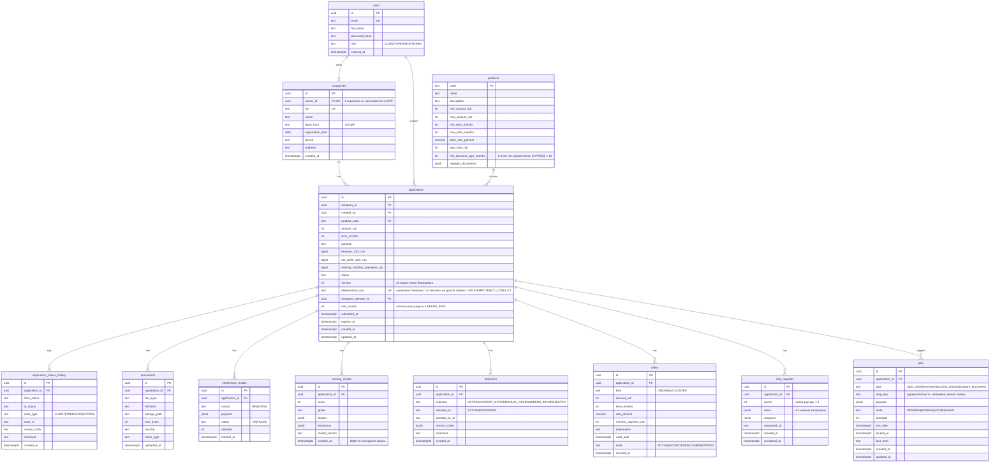

# Модель данных (v0.2; владелец Участник 2)

## Ограничения и индексы
- `applications.status` — `CHECK` по списку статусов из `STATE_MACHINE.md`; `product_code` — FK на `products`.
- `companies`: `CHECK` длины ИНН по форме (`OOO` — 10 цифр, `IP` — 12); один пользователь — одна компания (unique `owner_id`).
- `offers`: частичный unique `(application_id) WHERE state = 'ACTIVE'` — одна активная оферта на заявку.
- `jobs`: unique `(application_id, type, step_key)`; индекс `(state, run_after)` для выборки `FOR UPDATE SKIP LOCKED`.
- Индексы: `applications (status, updated_at DESC)`, `applications (company_id)`, `application_status_history (application_id, created_at)`, `enrichment_results (application_id, source)`.
- `scoring_results` и `decisions` только добавляются; актуальной считается последняя запись по `created_at`.

## Принципы
- Статус хранится в `applications.status`, история — в `application_status_history` (запись в одной транзакции с изменением).
- `applications.version` увеличивается при каждом изменении, обновления идут с проверкой версии.
- `idempotency_key` + уникальный индекс: повторная подача заявки не создаёт дубль.
- Данные скоринга и решения не перезаписываются, а добавляются (аудит: что и на каких данных было решено).
- `application_status_history.actor_id`: для `SYSTEM` — имя воркера, для остальных — id пользователя (text, без FK). Аудит `take` пишется строкой истории с `from_status = to_status = MANUAL_REVIEW` и `reason_code = TAKEN`.
- Документы: файл в томе `uploads/`, в БД только метаданные и `sha256`.
- Персональные и чувствительные поля не попадают в логи.
