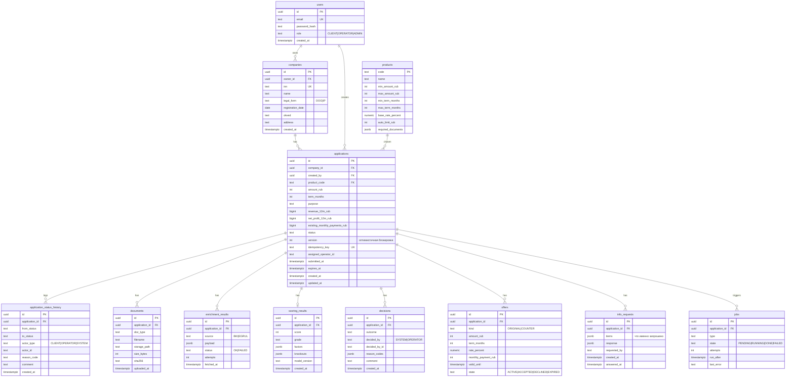

# Модель данных (черновик; финализирует Участник 2)

## Принципы
- Статус хранится в `applications.status`, история — в `application_status_history` (запись в одной транзакции с изменением).
- `applications.version` увеличивается при каждом изменении, обновления идут с проверкой версии.
- `idempotency_key` + уникальный индекс: повторная подача заявки не создаёт дубль.
- Данные скоринга и решения не перезаписываются, а добавляются (аудит: что и на каких данных было решено).
- Документы: файл в томе `uploads/`, в БД только метаданные и `sha256`.
- Персональные и чувствительные поля не попадают в логи.
