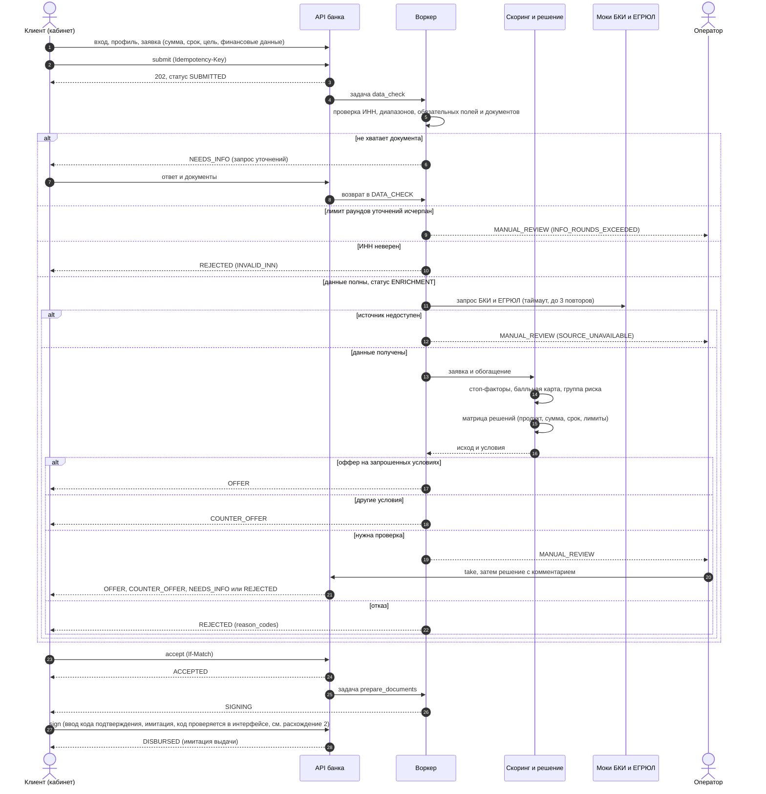
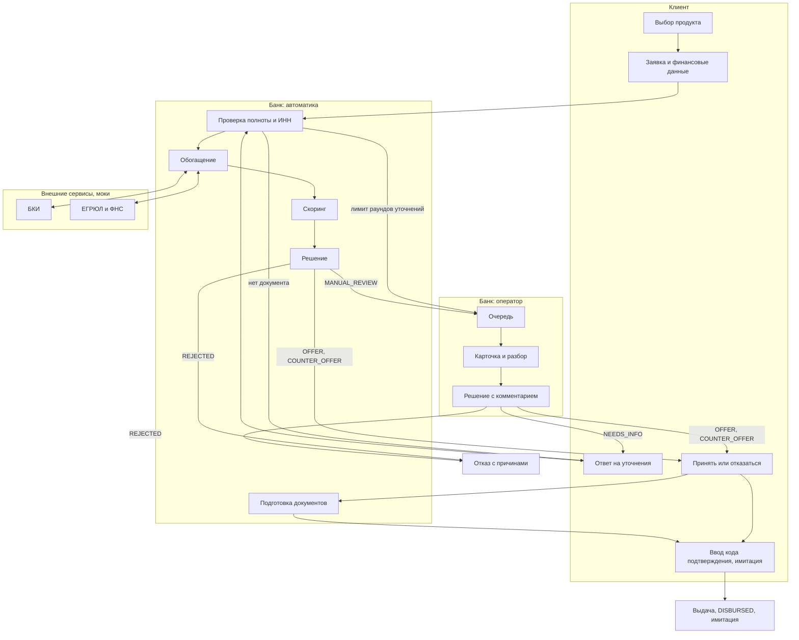

# Процессная модель кредитного конвейера

Владелец: Участник 1. Сверено с `STATE_MACHINE.md` (диаграмма и правила переходов), `SCORING.md`, `openapi.yaml` v0.2.0.

## Границы процесса

| | |
|---|---|
| Начало | Клиент действующего банка заходит в кабинет с потребностью в финансировании |
| Конец | `DISBURSED` (имитация выдачи), либо `REJECTED`, `CANCELLED`, `EXPIRED` |
| Не входит | Посткредитное обслуживание, реальное подписание и выдача денег, регистрация новых клиентов |
| Участники | Клиент (кабинет), банк (оператор, автоматика), внешние сервисы (моки БКИ и ЕГРЮЛ/ФНС) |

## Диаграмма: участники и обмен

## Диаграмма: данные и ответственность по этапам

## Данные на каждом этапе

| Этап | Данные на входе | Данные на выходе | Хранение |
|---|---|---|---|
| Профиль | ИНН, форма, название, дата регистрации, ОКВЭД, адрес | Профиль компании (сверен с ЕГРЮЛ) | `companies` |
| Заявка | Продукт, сумма, срок, цель, выручка, прибыль, текущие платежи | Заявка в статусе `DRAFT`, затем `SUBMITTED` | `applications` |
| Проверка данных | Заявка, профиль, документы | `ENRICHMENT`, `NEEDS_INFO`, `MANUAL_REVIEW` (`INFO_ROUNDS_EXCEEDED`) или `REJECTED` | `application_status_history`, `info_requests`, `documents` |
| Обогащение | ИНН | Балл и просрочки БКИ, статус и флаги реестра | `enrichment_results` |
| Скоринг | Заявка и обогащение | Балл 0–100, группа A–E, разбор по факторам, стоп-факторы | `scoring_results` |
| Решение | Скоринг, продукт, сумма, срок | Исход, условия, коды причин | `decisions`, `offers` |
| Ответ клиента | Оффер | `ACCEPTED` или `CANCELLED` | `offers`, история |
| Оформление | Принятый оффер | `SIGNING`, затем `DISBURSED` | история, аудит |

## Возможные исходы

| Исход | Когда | Кто решает |
|---|---|---|
| `OFFER` | Группы A и B (и C) в пределах платёжеспособности и автолимита продукта; оператор тоже может одобрить на запрошенных условиях после `MANUAL_REVIEW` | Система или оператор |
| `COUNTER_OFFER` | Сумма больше платёжеспособности клиента; в MVP сумма снижается до расчётной | Система или оператор |
| `NEEDS_INFO` | Не хватает документа, расхождение с реестром, запрос оператора | Система или оператор |
| `MANUAL_REVIEW` | Группа D, сумма выше автолимита, источник недоступен, исчерпаны раунды уточнений | Оператор |
| `REJECTED` | Стоп-факторы, группа E, неверный ИНН, платёжеспособность ниже минимума продукта | Система или оператор |
| `CANCELLED`, `EXPIRED` | Клиент отказался или сроки истекли | Клиент или таймеры воркера |

## Что сверено со `STATE_MACHINE.md`

Модель совпадает с диаграммой состояний: все 15 статусов, допустимые переходы, актор каждого перехода. Расхождения, найденные при сверке, перечислены ниже и переданы на согласование Кириллу (владелец автомата состояний); сам контракт без `contract`-PR мы не меняем.

| № | Расхождение | Где | Предложение |
|---|---|---|---|
| 1 | В `CONTRACT_CHANGES.md` (раунд 2, п. 1) сказано, что в `STATE_MACHINE.md` добавлен раздел «Цепочка после оффера», но в файле его нет | `STATE_MACHINE.md` | Добавить раздел или убрать ссылку |
| 2 | В `MVP.md` (допущение 4) подписание происходит вводом кода подтверждения, а ручка `POST /applications/{id}/sign` в `openapi.yaml` не принимает тела и кода | `MVP.md` и `openapi.yaml` | Решить: либо упростить `MVP.md` до кнопки «Подписать», либо добавить код в контракт |
| 3 | `SCORING.md` говорит о `NEEDS_INFO` с `REGISTRY_MISMATCH`, но таблица шагов воркера выдаёт `NEEDS_INFO` только на `DATA_CHECK` и только за документы. Диаграмма разрешает `SCORING → NEEDS_INFO`, при этом сверка с реестром возможна только после обогащения | `STATE_MACHINE.md` и `SCORING.md` | Явно указать, на каком шаге воркер сверяет данные с реестром |
| 4 | Поле `decision_highlights` для объяснения решения клиенту описано в `SCORING.md`, но в схеме `Application` отсутствует | `openapi.yaml` | `contract`-PR от Кирилла |
| 5 | `SCORING.md` для `PRODUCT_NOT_AVAILABLE` допускает `COUNTER_OFFER` с другим продуктом, но в MVP это отказ с причиной | `SCORING.md` | Оставить как есть (отказ), описано в README как упрощение |
